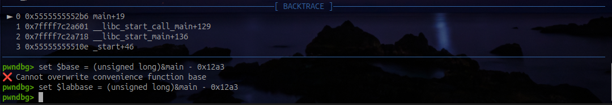
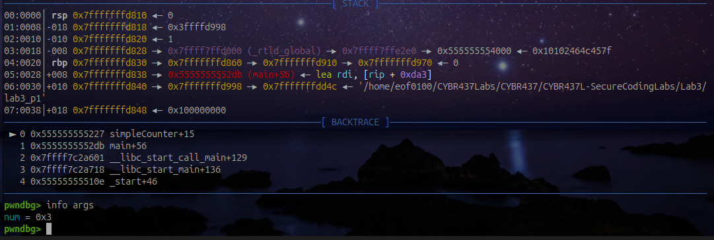
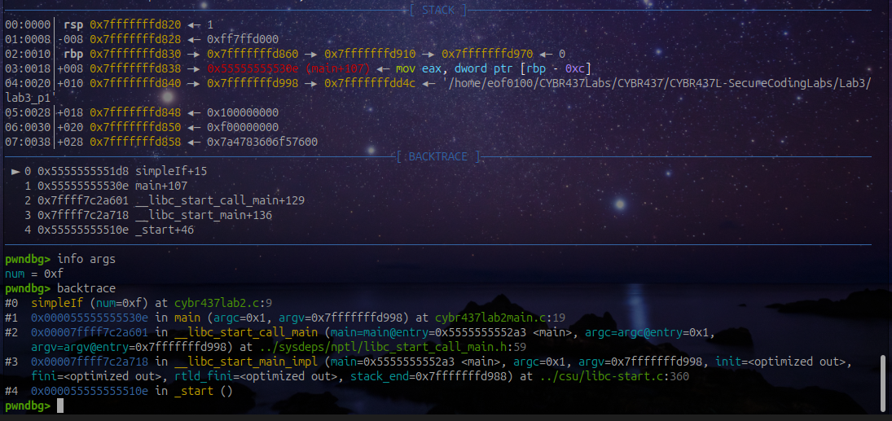
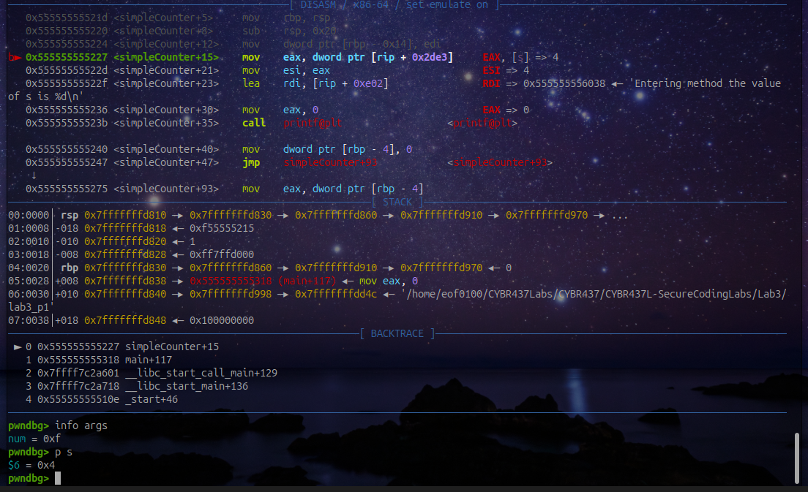

# CYBR 437 Secure Coding

## Lab 3 - PwnDBG

**Name:** Artem Peychev  
**Assignment:** Lab 3  
**Due date:** October 14, 2026

---

## Part 1

### Question 1

What is the name of the C file that contains main?

The name of the C file containing he main function is called cybr437lab2main.c

**Commands:**

```gdb
info functions main
```


### Question 2

Check the security of the binary and display the output inside pwndbg.

I used checksec inside pwndbg and the binary has Full RELRO, a stack canary, NX, and PIE enabled. SHSTK and IBT are also marked enabled. The binary is not stripped and does contain debugging information.

**Commands:**

```gdb
checksec
```


### Question 3

Disassemble main and identify the user-defined functions (print statements and function calls in proper order).

The user-defined functions are \<simpleCounter> and \<simpleIf>. The calls are in the following order: puts, simpleCounter(3), printf, scanf, simpleIf(num), and simpleCounter(num).

**Commands:**

```gdb
set disassembly-flavor intel
disassemble main
```


### Question 4

Set a breakpoint at main and on each of the identified functions. Run the program.

**Commands:**

```gdb
break main
break simpleCounter
break simpleIf
run
set $labbase = (unsigned long)&main - 0x12a3
```





### Question 5

What line are you at? What are the contents of the first string in main?

The program is stopped at line 9 in cybr437lab2main.c. 
The first string in main is:

“This is a pwndbg program”.

**Commands:**

```gdb
info line *$pc
x/s $labbase+0x206c
```


### Question 6

Display the current breakpoints, delete the one for main and set a new one at line 23, show the updated list of breakpoints.

I deleted breakpoint 1 at main and added a breakpoint at line 23 in cybr437lab2main.c but the breakpoints of simpleCounter and simpleIf are still there.

**Commands:**

```gdb
info breakpoints
delete 1
break cybr437lab2main.c:23
info breakpoints
```


### Question 7

Continue to the next breakpoint. What is the name and the value being passed into the function called?

The function called is simpleCounter, the parameter is named num and its value is 0x03 which is 3 in hexadecimal notation.

**Commands:**

```gdb
continue
info args
```





### Question 8

How do you show the current function and the one that called it? Show output.

I used backtrace, frame #0 shows simpleCounter as the current function with frame #1 is the caller. 

**Commands:**

```gdb
backtrace
```


### Question 9

Disassemble this function you are in, how many print functions are in this function? Hint: There is more than one type of print statement.

There are four output function calls in the disassembled code: 3 calls to printf and 1 call to putchar.

**Commands:**

```gdb
disassemble simpleCounter
```


### Question 10

Examining the disassembled code, grab the memory address of the constant from the 
function you’re stopped at and display its location in the process image. 

The constant VAR has a vlue of 100 at address 0x555555556068 which is stored real only data section called .rodata.

**Commands:**

```gdb
p/x &VAR
p VAR
x/wd $labbase+0x2068
vmmap $labbase+0x2068
info files
```


### Question 11

Continue running (enter 15). What function are you currently stopped at, what is the name and the value being passed into the function you are currently stopped at?

The program stopped in simpleIf with parameter named num and the value passed in is 15.

**Commands:**

```gdb
continue
# When the program asks Enter a number, type 15 and press Enter.
info args
backtrace
```





### Question 12

What is the value of the first string in this function you are stopped at, and what is the name and the type of the global variable in the function where you are stopped in? Hint: notice the legend.

The first string in simpleIf says  “Congrats you won”. The global var is MAX of type constant double.

**Commands:**

```gdb
disassemble simpleIf
x/s $labbase+0x2008
x/s $labbase+0x2019
whatis MAX
p MAX
p/x &MAX
vmmap $labbase+0x4020
```


### Question 13

Look for the cmp instruction in the assembly from the disassembled code. What value is the variable from question 14 being compared to?

The variable is compared to 0xc, which is 12 in decimal.

**Commands:**

```gdb
disassemble simpleIf
p num
```


### Question 14

What area of the process image is the variable s located, what storage class is it? Hint: notice the value of s as it enters the function that is called twice.

The variable s is stored in .data section and has a Statoc Storage Class. Its value starts at 1 and then it is 4 when simpleCounter function is called the second time.

**Commands:**

```gdb
p s
p/x &s
vmmap $labbase+0x4010
info variables s
continue
info args
p s
p/x &s
vmmap $labbase+0x4010
```





### Question 15

Display 64 addresses of the stack (NOTE: this is not backtrace).

I used x/64gx $rsp command to display 64 8-byte items on the stack starting at the current pointer in the stack.

**Commands:**

```gdb
x/64gx $rsp
```


---

## Part 2: Stack frames for main and foo

Using the addresses supplied in the handout, draw the stack frames for both `main` and `foo`. Clearly label each variable and its memory location. High memory must be at the top.


