# CYBR 437 Secure Coding

## Lab 3

**Name:** Artem Peychev  
**Institution:** Eastern Washington University  
**Quarter:** Fall 2026  
**Due date:** October 14, 2026, at 11:59 pm

---

## Part 1

### Question 1

What is the name of the C file that contains main?

**Commands:**

```gdb
info sources
info functions main
```

<answer here>

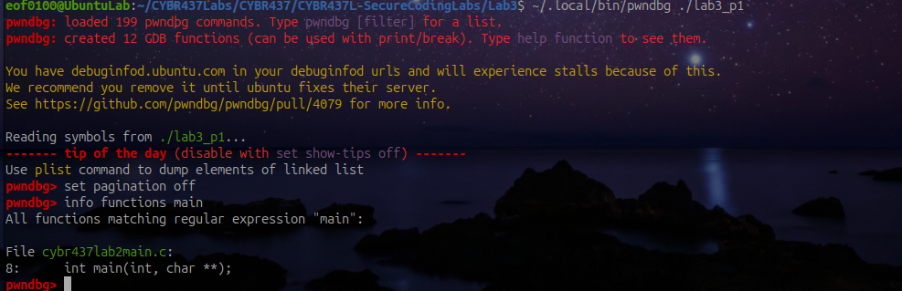

### Question 2

Check the security of the binary and display the output inside pwndbg.

**Commands:**

```gdb
checksec
```

<answer here>

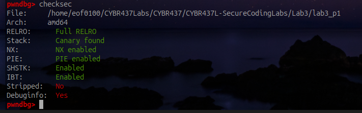

### Question 3

Disassemble main and identify the user-defined functions (print statements and function calls in proper order).

**Commands:**

```gdb
disassemble main
```

<answer here>

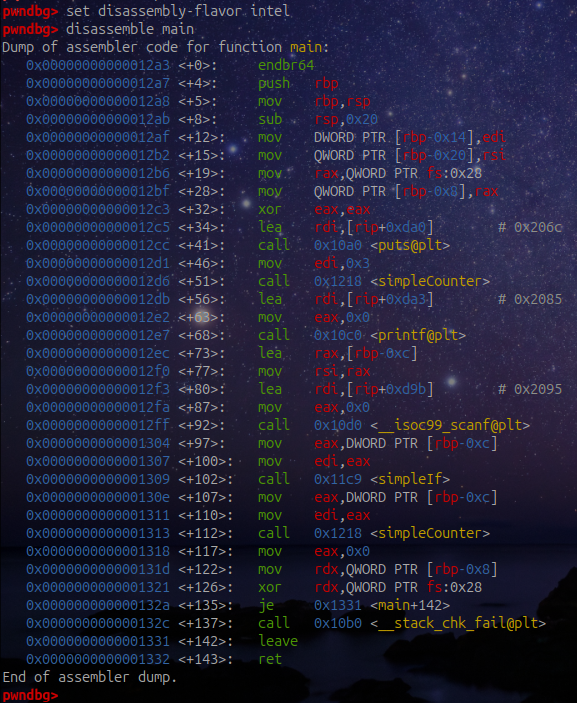

### Question 4

Set a breakpoint at main and on each of the identified functions. Run the program.

**Commands:**

```gdb
break main
break simpleCounter
break simpleIf
run
set $base = (unsigned long)&main - 0x12a3
```

<answer here>

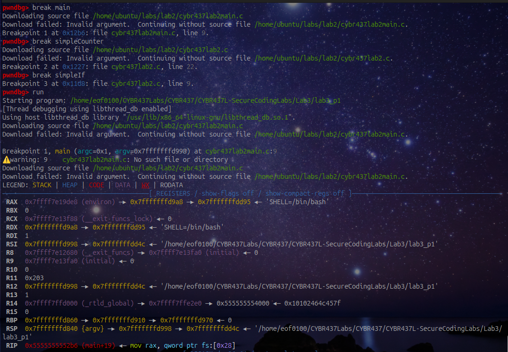

### Question 5

What line are you at? What are the contents of the first string in main?

**Commands:**

```gdb
info line *$pc
x/s $base+0x206c
```

<answer here>

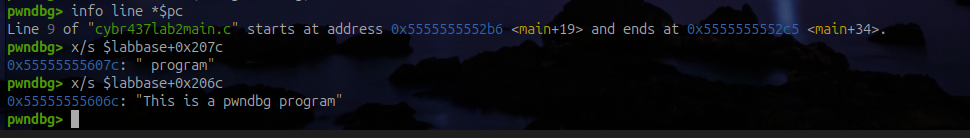

### Question 6

Display the current breakpoints, delete the one for main and set a new one at line 23, show the updated list of breakpoints.

**Commands:**

```gdb
info breakpoints
delete 1
break cybr437lab2main.c:23
info breakpoints
```

<answer here>

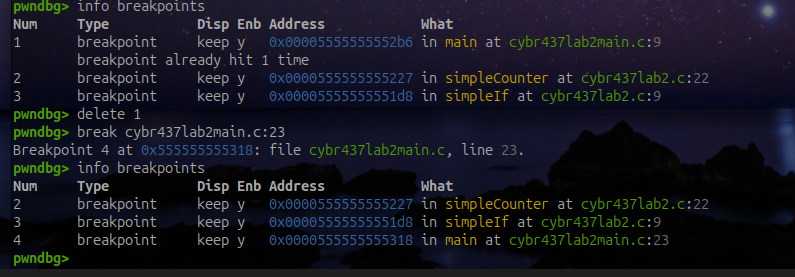

### Question 7

Continue to the next breakpoint. What is the name and the value being passed into the function called?

**Commands:**

```gdb
continue
info args
```

<answer here>

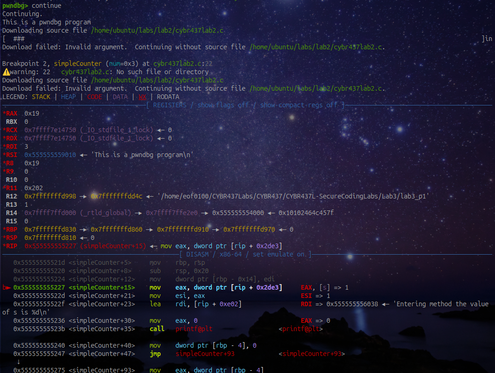

### Question 8

How do you show the current function and the one that called it? Show output.

**Commands:**

```gdb
backtrace
```

<answer here>

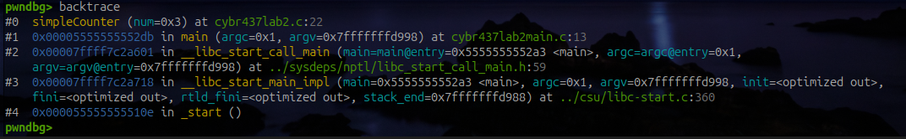

### Question 9

Disassemble this function you are in, how many print functions are in this function? Hint: There is more than one type of print statement.

**Commands:**

```gdb
disassemble simpleCounter
```

<answer here>

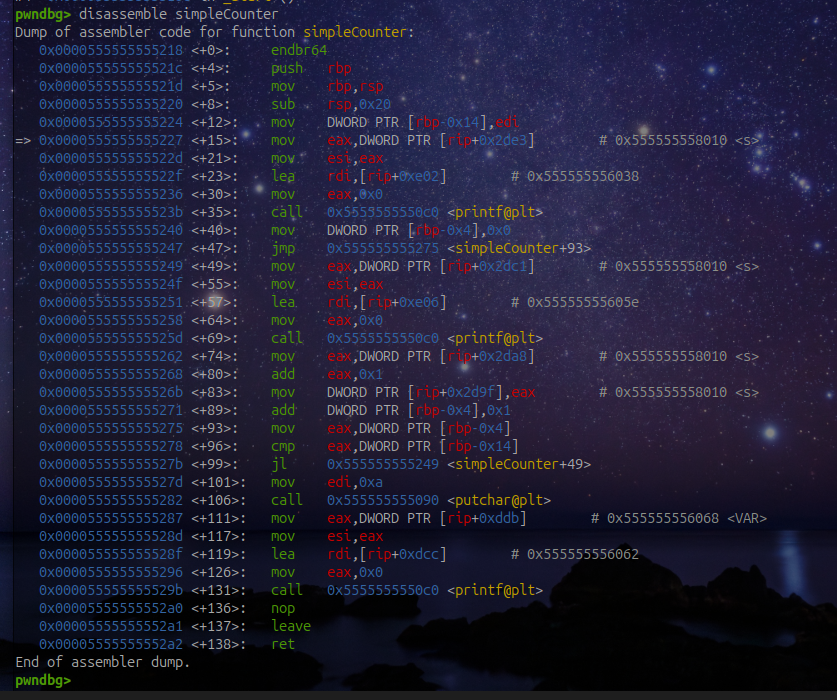

### Question 10

Examining the disassembled code, grab the memory address of the constant from the function you are stopped at and display its location in the process image.

**Commands:**

```gdb
p/x &VAR
p VAR
x/wd $base+0x2068
vmmap $base+0x2068
info files
```

<answer here>

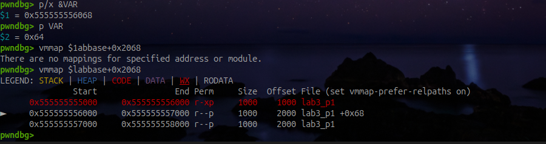

### Question 11

Continue running (enter 15). What function are you currently stopped at, what is the name and the value being passed into the function you are currently stopped at?

**Commands:**

```gdb
continue
# When the program asks Enter a number, type 15 and press Enter.
info args
backtrace
```

<answer here>

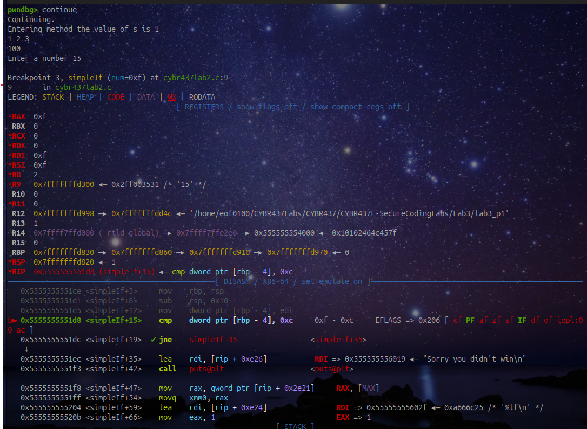

### Question 12

What is the value of the first string in this function you are stopped at, and what is the name and the type of the global variable in the function where you are stopped in? Hint: notice the legend.

**Commands:**

```gdb
disassemble simpleIf
x/s $base+0x2008
x/s $base+0x2019
whatis MAX
p MAX
p/x &MAX
vmmap $base+0x4020
```

<answer here>

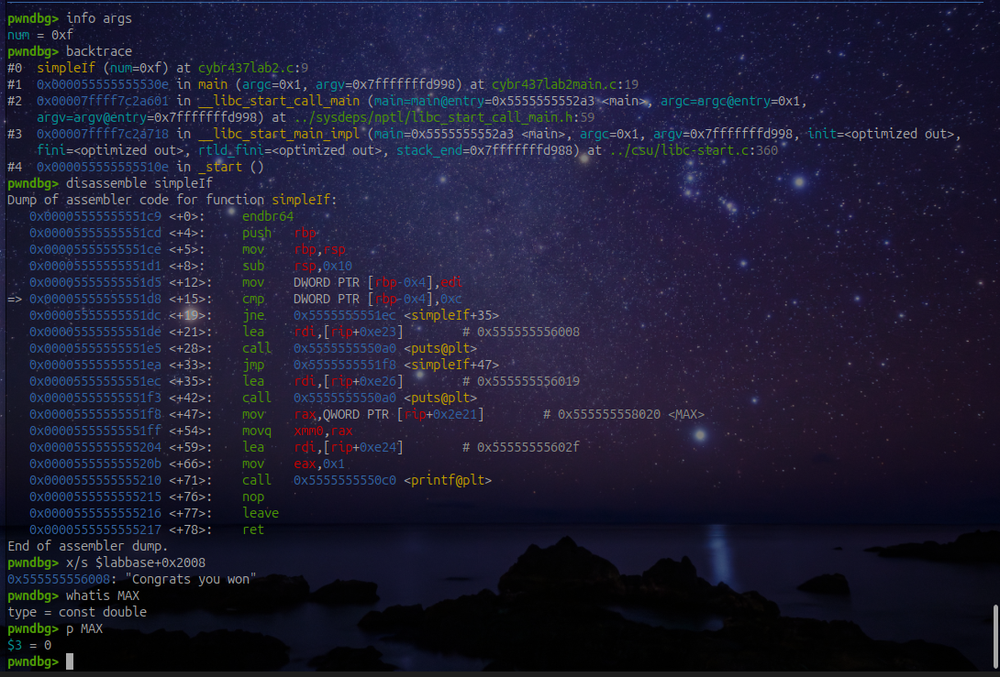

### Question 13

Look for the cmp instruction in the assembly from the disassembled code. What value is the variable from question 14 being compared to?

**Commands:**

```gdb
disassemble simpleIf
p num
```

<answer here>


### Question 14

What area of the process image is the variable s located, what storage class is it? Hint: notice the value of s as it enters the function that is called twice.

**Commands:**

```gdb
p s
p/x &s
vmmap $base+0x4010
info variables s
continue
info args
p s
p/x &s
vmmap $base+0x4010
```

<answer here>

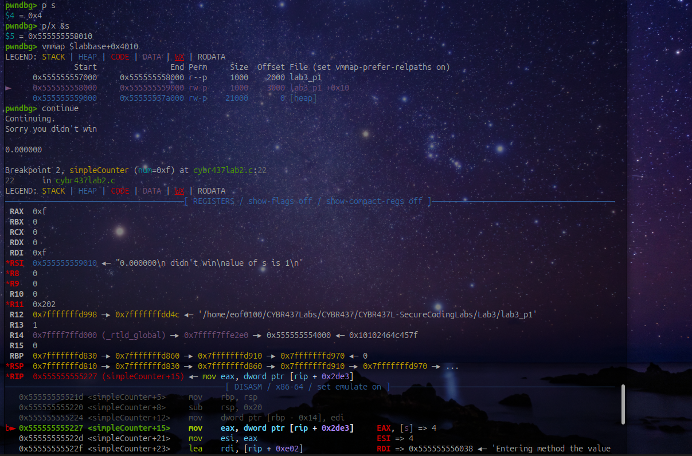

### Question 15

Display 64 addresses of the stack (NOTE: this is not backtrace).

**Commands:**

```gdb
telescope $rsp 64
x/64gx $rsp
```

<answer here>

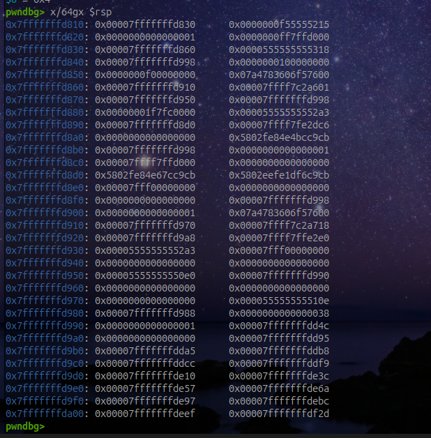

---

## Part 2: Stack frames for main and foo

Using the addresses supplied in the handout, draw the stack frames for both `main` and `foo`. Clearly label each variable and its memory location. High memory must be at the top.

<answer here>

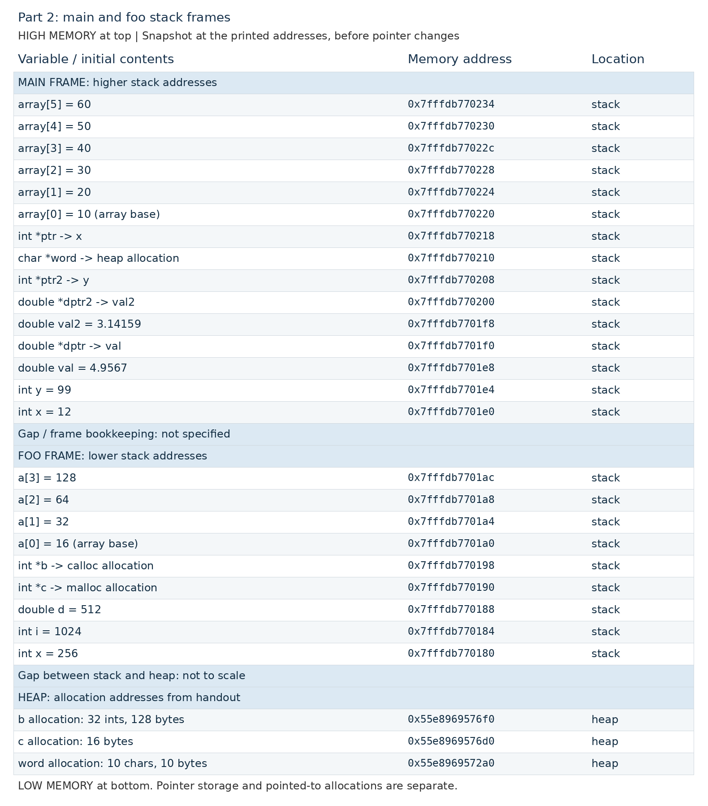
