# CYBR 437 Secure Coding

## Lab 4: Regular Expressions and Static Analysis

**Name:** Artem Peychev  
**Class:** CYBR437 Secure Coding 
**Assignment:** Lab 4 - Static Analysis with Regular Expressions
**Due date:** October 21, 2026

---


## Part 1: Regular Expressions


### Problem 1: Social Security Number (SSN) (20 points)

Create a pattern for an SSN with exactly nine digits. Optional dashes or whitespace may occur only between digits 3 and 4 and/or digits 5 and 6. Mixed separators and omitted separators are allowed by the examples.

The stated rules are:

1. None of the three segments may consist entirely of zeros.
2. Reject nine identical digits and the consecutive sequence 123456789, including separated forms.
3. The handout states that SSA issues digits 1, 8, and 9 only in position 1.
4. An SSN starting with 9 must have 9 in position 4.
5. Reject 666 in positions 1 through 3.
6. There must be exactly nine digits.


#### Social Security 

I started with a pattern that first matched the overall syntax of the SSN's. First I started with a pattern that matched three digits followed by two digits followed by four digits. Between each group of digits I added a dash or whitespace which is optional and not required. Using regex101.com, I came up with the following regular expression that worked.

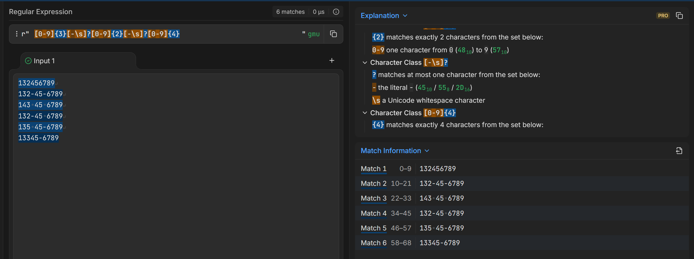

Then I added what is called negative lookaheads to reject rule 1 and 5 which will reject 000 or 666 in the first grouping, 00 in the middle grouping, and 0000 in the last grouping.

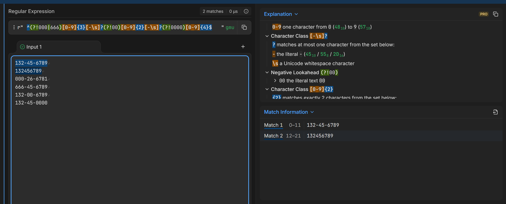


Then I added check to reject consecutive sequence of numbers 1234567789 and nine any identical numbers which includes with and without seperators.


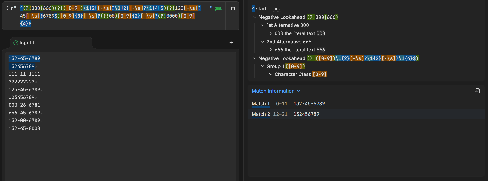

Then I moved on to rule #4 which rejects SSN's that start with a 9 but the fourth digit is anything from 0-8 (9 is allowed). This means that a number starting with a 9 must have the fourth digit be also a 9.

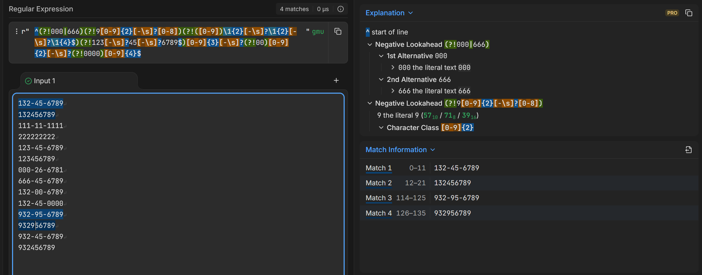

The final regular expression ended up being below. Then I added the regular expression to the python script and used the regex testing script to make sure it passed all the tests for valid SSN's and made sure to fail for all invalid SSN's.


#### Final Regular expression:

```python
regex = r"^(?!000|666)(?!9[0-9]{2}[-\s]?[0-8])(?!([0-9])\1{2}[-\s]?\1{2}[-\s]?\1{4}$)(?!123[-\s]?45[-\s]?6789$)[0-9]{3}[-\s]?(?!00)[0-9]{2}[-\s]?(?!0000)[0-9]{4}$"
```
### How my SSN pattern works

| Pattern part | What it does |
|---|---|
| `^` | Starts checking at the beginning of the SSN. |
| `(?!000|666)` | Rejects SSNs that start with `000` or `666`. |
| `(?!9[0-9]{2}[-\s]?[0-8])` | If the first group starts with `9`, rejects a second group that starts with a digit from `0` through `8`. |
| `(?!([0-9])\1{2}[-\s]?\1{2}[-\s]?\1{4}$)` | Rejects SSNs where all nine digits are identical, such as `111-11-1111`. `([0-9])` captures the first digit, and `\1` matches that same digit again. |
| `(?!123[-\s]?45[-\s]?6789$)` | Rejects `123-45-6789`, including versions with whitespace or no separators. |
| `[0-9]{3}` | Requires exactly three digits in the first group. |
| `[-\s]?` | Allows an optional hyphen or one whitespace character between groups. This appears twice in the pattern. |
| `(?!00)[0-9]{2}` | Requires exactly two digits in the second group and rejects `00`. |
| `(?!0000)[0-9]{4}` | Requires exactly four digits in the last group and rejects `0000`. |
| `$` | Marks the end of the SSN. |

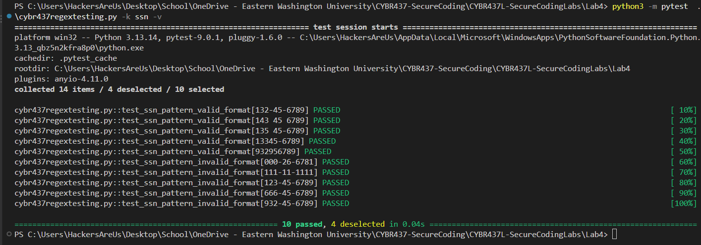


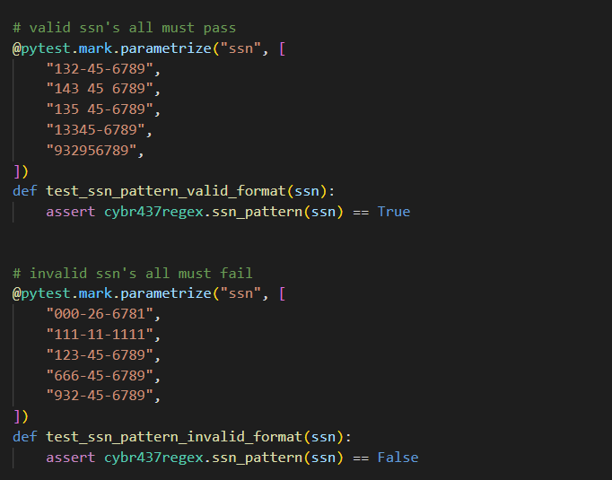


#### Shortcomings

Rule 3 states that the digits 1,8,9 are issued only in position 1. It I take this rule literally this causes conflicts with valid SSN examples such as 132-45-6789 which contain digits 8 and 9 in the last two positions. Also, this conflics with rule #4 which says if the first digit is a 9 the fourth digit must also be a 9. So what I did as a compromise, I implemented the rule #4 but did not implement rule #3.


--- 


### Problem 2: Email Address (20 points)

Create a pattern with a local part and a domain separated by one @ symbol.

1. The local part must contain at least one character.
2. The domain must contain at least four characters.
3. The allowed special characters are hyphen (-), underscore (_), and dot (.).
4. A dot cannot be the first character or immediately precede @.
5. Consecutive dots are not allowed anywhere in the email address.
6. The dot restrictions do not apply to hyphens or underscores.

For the e-mail pattern using regex101.com, I created a pattern that checks for local part which contains at minimum one character, domain separated by @ must contain at least four characters. Both parts do allow letters, numbers, hyphens, underscores, and dots according to the 6 rules.

I first came up with a pattern that simply rejects addresses that start with a period, contain a period immediately before the @ sign, and any consecutive dots anywhere in the e-mail address. Here is a screenshot of the regular expression that pass initial test cases:


#### Regular expression

```python
regex = r"^(?!\.)(?!.*\.\.)[A-Za-z0-9_.-]+(?<!\.)@[A-Za-z0-9_.-]{4,}$"
```

### How my email pattern works

| Pattern part | What it does |
|---|---|
| `^` | Starts checking at the beginning of the email. |
| `(?!\.)` | Prevents the email from starting with a period. |
| `(?!.*\.\.)` | Rejects two consecutive periods anywhere in the email. |
| `[A-Za-z0-9_.-]+` | Requires one or more letters, digits, underscores, periods, or hyphens before the `@`. |
| `(?<!\.)` | Prevents the character immediately before the `@` from being a period. |
| `@` | Requires the literal `@` symbol. |
| `[A-Za-z0-9_.-]{4,}` | Requires at least four characters after the `@`, using letters, digits, underscores, periods, or hyphens. |
| `$` | Marks the end of the email. |


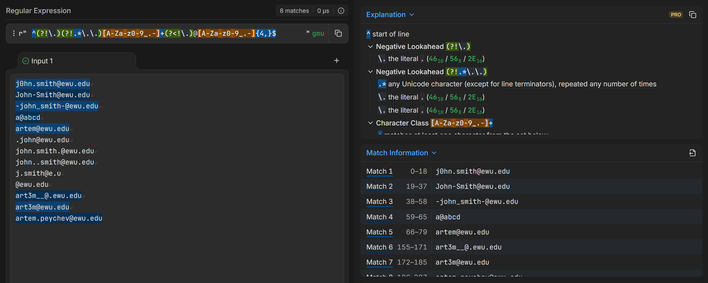

Once I added the regular expression to cybr437regex.py, then I added valid and invalid test cases to cybr437regextesting.py and passed all 11 tests.  

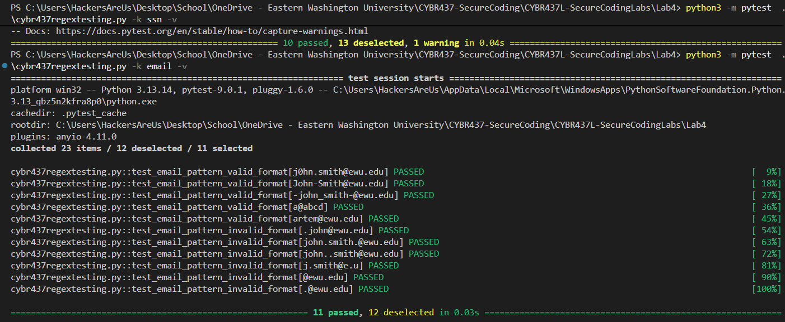

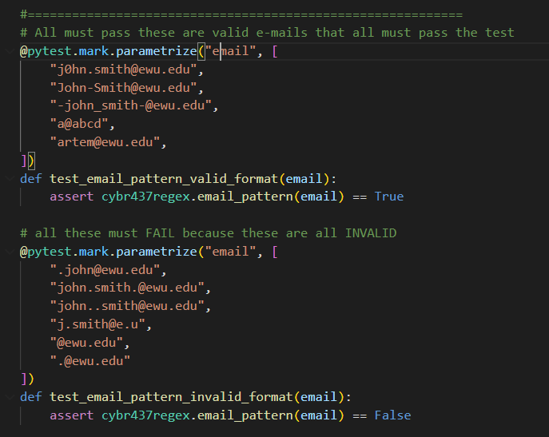


#### Shortcomings

My pattern accepts domains without a dot, for example a@abcd, because the instructions require at least four characters after @ but do not require a domain extension. It also allows dots at the beginning or end of the domain because those positions are not prohibited. Consecutive dots are rejected anywhere in the address.
The pattern follows the lab’s limited character rules rather than a real email standard from the real world. But all five valid and six invalid Python tests produced the expected results.

Note: I added the sixth test myself to test .@ewu.edu which tests both a dot in the beginning and a dot before the @ symbol.


---

### Problem 3: Password (20 points)

Create a password pattern that meets these requirements:

1. At least ten characters.
2. At least one uppercase letter.
3. At least one lowercase letter.
4. At least one digit.
5. At least one punctuation mark.
6. No more than three consecutive lowercase letters.
7. The handout states that the password must not contain "two digits that repeat."
8. The first character must be a lowercase letter or a punctuation mark.


I created a regular expression pattern that checks for at least ten characters, including at least one uppercase letter, one lowercase letter, one digit, and one punctuation mark. It also checks that the password starts with a lowercase letter or punctuation and does not contain more than three consecutive lowercase letters. Rule #7, I interpreted the rule "two digits that repeat" as pair of two digits such as 1515 or 1313 and not 33 because one of the valid examples that is suppose to pass "t3sTingM33!" contains 33 which are two consecutive digit.
I tested the five valid and five invalid examples from the instructions in regex101.com and as the screenshot shows the first five valid examples all matched and the other five did not.

#### Regular expression

```python
regex = r"^(?=.{10,}$)(?=.*[A-Z])(?=.*[a-z])(?=.*[0-9])(?=.*[!-/:-@\[-`{-~])(?!.*[a-z]{4})(?!.*([0-9]{2}).*\1)[a-z!-/:-@\[-`{-~].*$"
```


| Pattern part | What it does |
|---|---|
| `^` | Starts checking at the beginning of the password. |
| `(?=.{10,}$)` | Checks that the password has at least ten characters. |
| `(?=.*[A-Z])` | Requires at least one uppercase letter. |
| `(?=.*[a-z])` | Requires at least one lowercase letter. |
| `(?=.*[0-9])` | Requires at least one digit. |
| `` (?=.*[!-/:-@\[-`{-~]) `` | Requires at least one ASCII punctuation mark. |
| `(?!.*[a-z]{4})` | Rejects four consecutive lowercase letters, so no more than three are allowed together. |
| `(?!.*([0-9]{2}).*\1)` | Captures a pair of digits and rejects the password if that same pair appears again later. `\1` refers to the captured pair. |
| `` [a-z!-/:-@\[-`{-~] `` | Requires the first character to be a lowercase letter or punctuation mark. |
| `.*$` | Matches the remaining characters through the end of the password. |


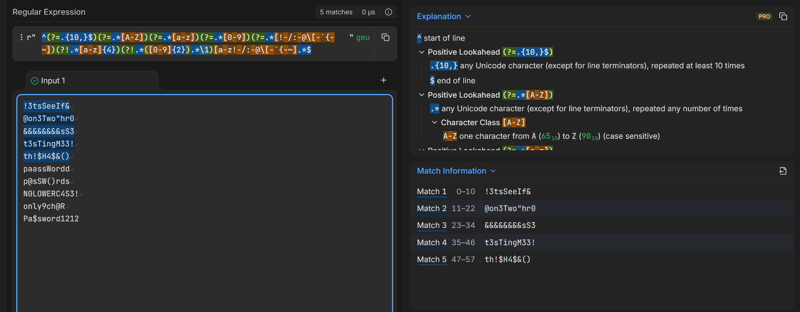

After adding valid and invalid tests to cybr437regextesting.py, running the password tests all passed.

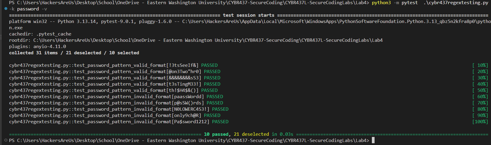

Below shows the valid and invalid testing code that I added to cybr437regextesting.py

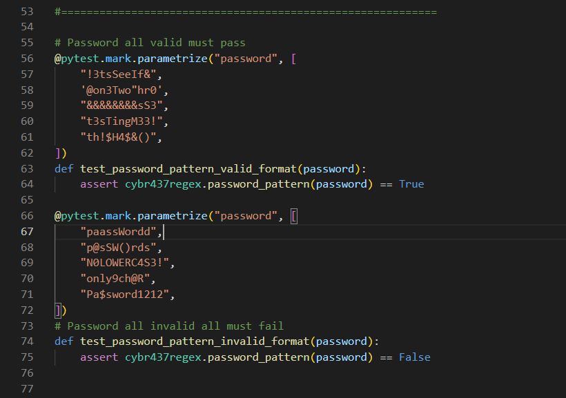

#### Shortcomings

I interpreted “two digits that repeat” as a repeated pair of digits, such as 1212, where 12 appears twice. I allowed repeated individual digits such as 33 because the instructions include t3sTingM33! as a valid example. All five valid and five invalid password tests passed without issues.


## Part 2: Static Analysis and Regex Scanner (40 points)

### Task 1: Analyze task1.c with Four Tools (15 points)

Analyze `task1.c` with cppcheck, flawfinder, splint, and Clang Static Analyzer. Explain each tool's output and compare the results.

#### cppcheck

**Command:**

```bash
cppcheck --enable=all --inconclusive task1.c
```

--enable=all option adds additional checks like portability   
--inconclusive includes issues that require manual verification by the user  

The tool cppcheck detected around two dozen findings. For example, on line 30 arr[3] accessed at index 5 which is out of bounds. Line 34, unsafe use of gets(). Memory pointed by buf2r1 is freed twice instead of just once. On 43, if memory allocation fails it warns a possible null pointer dereference. Lines 52 and 54 null pointer dereference. Lines 24 and 25 memory is allocated but it was never used. The Active checker reports 119/975 active checks.

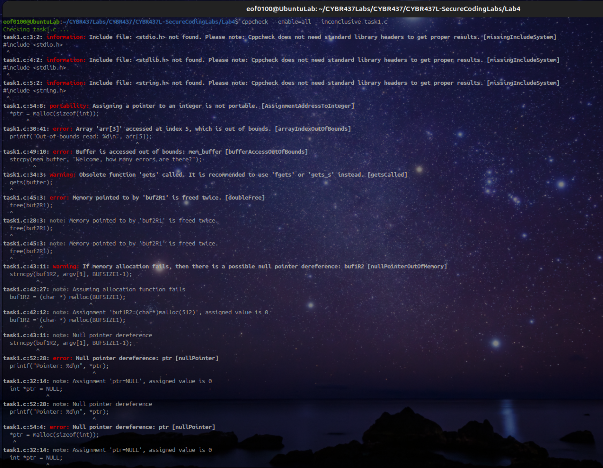

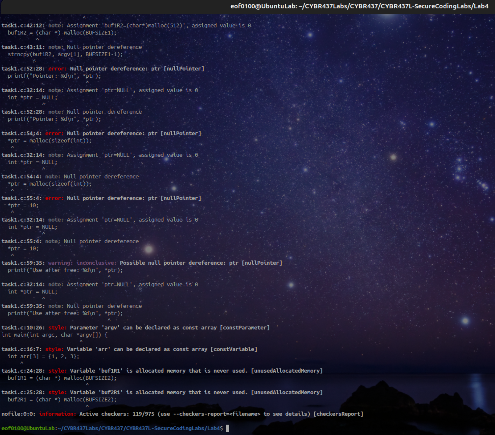

#### flawfinder

Flawfinder reported six possible issues in task1.c. It flagged gets() on line 34 because it does not limit input and can overflow the buffer. It also flagged printf(buffer) on line 22 because user input is being used as the format string. The character arrays on lines 15 and 48 were flagged because their fixed sizes require careful bounds checking. On line 49, strcpy() copies a string that is too large for the destination buffer. Then, strncpy() on line 43 because it might not add a null terminator and does not check whether the pointers are valid. Unlike cppcheck, Flawfinder did not report the double free or the out of bounds array access so it is beneficial to use more than one tool.

**Command used:**

```bash
flawfinder task1.c
```

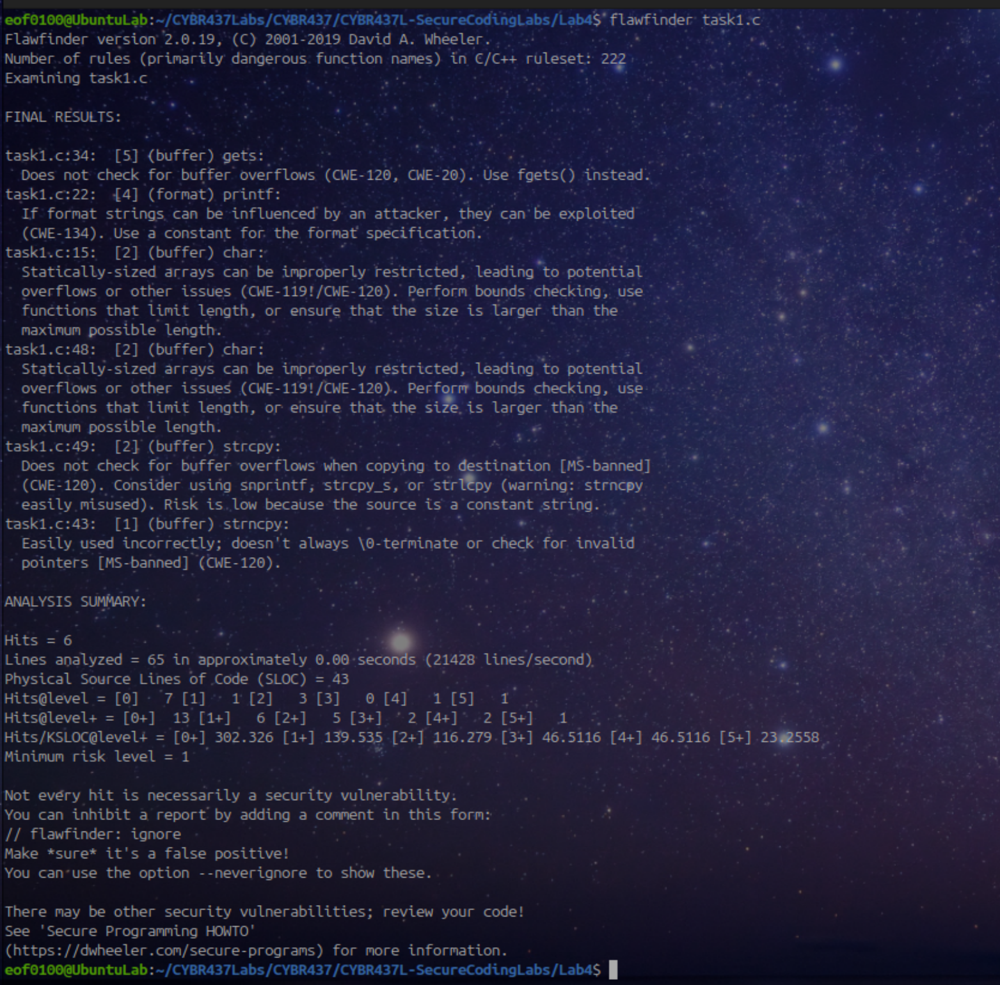


I ran splint task1.c, which reported ten warnings. It found ignored return values from snprintf and gets, unsafe use of gets, and the format string issue in printf(buffer). It also warned that strncpy receives a pointer that could be null if malloc() fails. Splint detected that buf2R1 is freed twice and that line 52 dereferences a null pointer. On line 54, it reported that a pointer is incorrectly assigned to an integer. It also reported a possible memory leak when that value is overwritten on line 55 and use of ptr after it is freed on line 59.


**Command used:**


```bash
splint task1.c
```

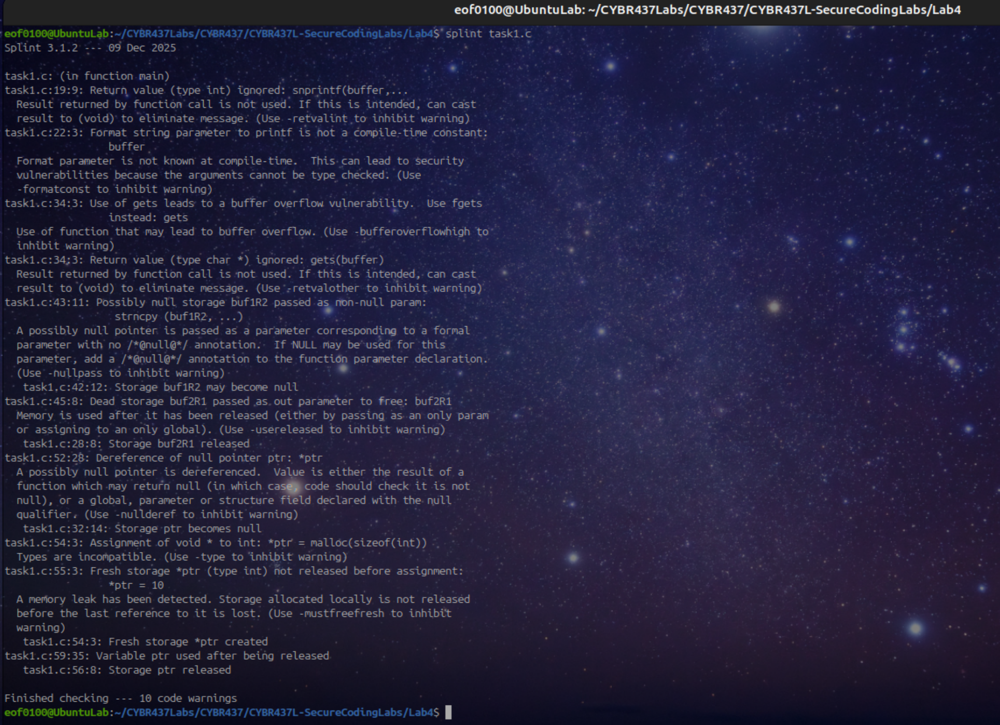

My first Clang analysis stopped because gets was undeclared and line 54 assigned the pointer returned by malloc to an integer. I reran it with those errors treated as warnings so the analyzer could continue without changing the supplied code.


**Command used:**


```bash
clang --analyze task1.c
```

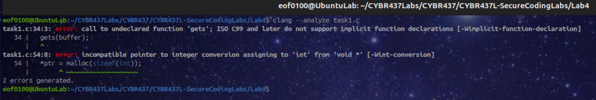


Clang then reported one analyzer warning on line 30, saying the second argument passed to printf() was an uninitialized value. That arg is arr[5], which is outside the array’s valid indexes of 0 through 2. This run did not report the other memory problems identified by cppcheck and Splint. Like I said earlier, it is beneficial to use more than one tool.


**Command used:**


```bash
clang --analyze -Wno-error=implicit-function-declaration -Wno-error=int-conversion task1.c
```

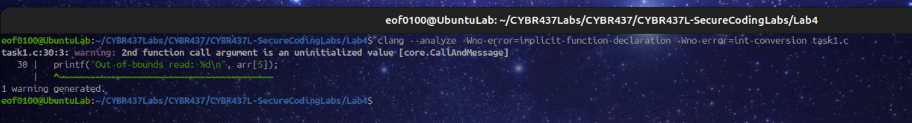


#### Comparing the four tools

The tools found different problems in the same code. cppcheck identified array bounds errors, a buffer overflow, a double free, and null pointer problems. Flawfinder focused on unsafe functions such as gets(), printf(), and strcpy(), and gave each finding a risk level analysis which was pretty beneficial. Splint reported several of the same issues, along with ignored return values, a possible memory leak, and use of a freed pointer. Clang initially stopped on errors, and after adjusting the command (ignoring the warning given), it reported one warning involving arr[5]. These results showed me why using more than one tool is useful, since no single run reported every issue.

---

### Task 2: Python Regex Scanner for Vulnerable Functions 

Write a Python program that uses regex to detect vulnerable or deprecated function uses in C source files. Run it against `task2.c`. For every occurrence, output a message, its line number, and the line of C code.

**Scanner filename:** `regex_vuln_scanner.py`

#### Regex Vuln Scanner Source Code

```python
import re
import sys

# unsafe functions to search for and description of why they're not safe
functions = {
    "gets": "No limit how much input is read.",
    "strcpy": "Does not check if the copied text fits.",
    "strncpy": "Might not put a null character at the end.",
    "strcat": "Doesn't check if there is room to add more text.",
    "sprintf": "Doesn't limit how much text it writes.",
    "vsprintf": "Does not limit how much text it writes.",
    "scanf": "Can read too much text if %s has no size limit.",
    "sscanf": "Can read too much text if %s has no size limit.",
    "fscanf": "Can read too much text if %s has no size limit.",
    "itoa": "Nonstandard in C and does not take size of buffer.",
}

# regex matches unsafe func names gets OR strcpy OR strcat etc etc
pattern = r"\b(gets|strcpy|strncpy|strcat|sprintf|vsprintf|scanf|sscanf|fscanf|itoa)\s*\("


def scan_file(filename):
    # keeps track of line numbers so it is easier to find unsafe code
    count = 0

    # open filename in read mode
    with open(filename, "r", encoding="utf-8") as file:

        # read each line + count line nums
        for line_number, line in enumerate(file, start=1):

            # find every single match, this works even if there is
            # more than one atch on a single line 
            for match in re.finditer(pattern, line):
                name = match.group(1)

                # print out the func, reaosn flagged, and source code
                print(f"Line {line_number}: {name}")
                print(f"Warning: {functions[name]}")
                print(f"Code: {line.strip()}")
                print()

                count = count + 1

    print(f"Total occurrences found: {count}")


# only runs if its not imported as module
if __name__ == "__main__":

    # make sure a filename was entered right after script name arg position 1
    if len(sys.argv) != 2:
        print("Usage: python3 regex_scanner.py task2.c")
        sys.exit(1)

    # show error cant open, read, or file doesnt exist
    try:
        scan_file(sys.argv[1])
    except (OSError, UnicodeError) as error:
        print(f"Could not open or read the file: {error}")
        sys.exit(1)
```


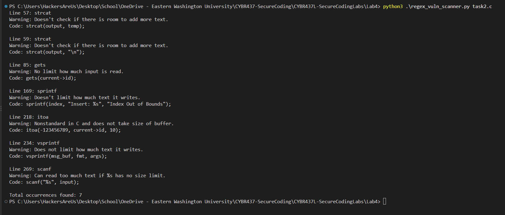


#### Explanation of my code

I used re to search with regex and sys to get the filename from the command line as arguments. The functions dictionary stores the function names I want to flag and a short warning for each one. The regular expression uses | means OR to search for any of those names. The \b checks the word boundary so it does not match a name inside a longer word. The \s* allows spaces between name of the function and the opening parenthesis, and the part \( matches those parenthesis.
The scan_file() function opens the file getting the filename as the second argument (the first argument is the script itself) and reads it one line at a time. I used enumerate() starting at 1 to keep track of the source line numbers, re.finditer() finds every occurrence, including multiple matches on the same line. For each match, group(1) gets the function name, and the program prints the line number, warning, and source code. It also counts the matches and prints the total. The main section checks that a filename was provided and catches errors if the file cannot be opened.

#### Explanation of the output

I ran my scanner called regex_vuln_scanner.py against task2.c, and it found seven occurrences. It flagged strcat() on lines 57 and 59, gets() on line 85, sprintf() on line 169, itoa() on line 218, vsprintf() on line 234, and scanf() on line 269. Each result includes the function name, a warning explaining why it needs review, its line number, and the source of function.

#### Limitations

My scanner searches for specific function names, so it cannot detect every vulnerability since there are many more unsafe functions in C than I have in my dictionary. It does not check argument sizes or determine whether a particular call is safe. Another limitation is the scanner searches text so it can flag something that looks like a function call even though it isn't even executed (part of the print statement). Also, the scanner looks for a function name and paranthesis on the same line, for example gets(bufferIn), but it may miss it if gets is on one liner and (bufferIn) is on another (which is still valid syntax in C)


