Artem Peychev  
CYBR437 Secure Coding  
Lab 5

# Part 1: Assembly into C
I used no optimization when compiling so I could compare the assembly with the handout. Part 1 uses the same setup without a stack canary as the examples. Part 3 was compiled separately with stack protection turned on.

## Task 1

### Code

```c
int main(void) {
    // First movl puts 25 put into a
    int a = 25;
    // Next movl puts 30 to b
    int b = 30;
    // movq puts 45 to c
    long c = 45;

    // add adds a and b subtract c then mov saves to c
    c = a + b - c;
    // The last mov puts 0 in eax for the return value
    return 0;
}
```

### What it does

First movl stores 25 in a. In the assembly this number is 0x19. It goes at rbp minus 4. The next movl stores 30 in b which is 0x1e, at rbp minus 8. Then movq stores 45 in c which is 0x2d, at rbp minus 16.

I used int for a and b because movl stores 4 bytes. I used long for c because movq stores 8 bytes and long has that size on this system.

Then mov loads a into edx and b into eax. The add instruction adds them so now the result is 55. Next cltq takes the signed 32 bit result in eax and makes it a signed 64 bit result in rax. This lets it work with the long variable.

The sub instruction takes away the old c value of 45. So 55 minus 45 gives 10. The next mov saves 10 back in c. This is what the line c equals a plus b minus c does.

The last mov puts 0 in eax for return 0. Push saves the old rbp and mov sets up the new stack frame. Pop restores rbp and ret returns from the function. Endbr64 is a protection instruction for jumps into the function.


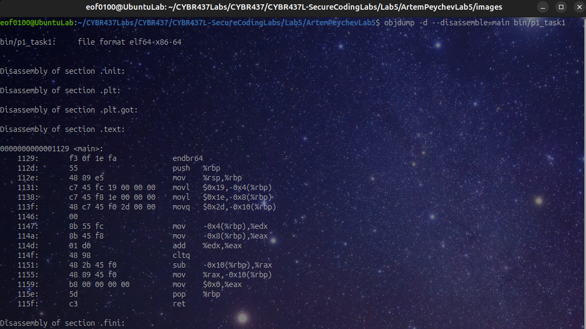

The assembly has the same numbers, stack positions, add, cltq and sub as the handout. It also saves the result back in c.

## Task 2


```c
int main(void) {
    // The first two movl store three #'s
    int a = 25;
    int b = 30;
    int result;

    // mov loads a, then cmp compares a with b.
    // jle goes to the else part if a is > b
    if (a > b) {
        // movl stores 1 
        result = 1;
    } else {
        // This is where jle goes. the movl stores zero
        result = 0;
    }
    // Put 0 in eax 
    return 0;
}
```

### What it does

The first two movl instructions store 25 and 30 in a and b. They use the stack positions rbp minus 4 and rbp minus 8. Then mov loads a into eax and cmp compares it with b.

Jle means jump if less than or equal. So if a is less than or equal to b it goes to the part that stores 0 in result. Result is at rbp minus 12.

If a is bigger than b it does not take that jump. It stores 1 in result instead. Then jmp skips the part that stores 0. So this is an if and else in C. For these numbers 25 is smaller than 30, so result becomes 0.

The last mov puts 0 in eax because main returns 0. Push, mov, pop and ret handle starting and ending the function. Endbr64 is there for control flow protection.


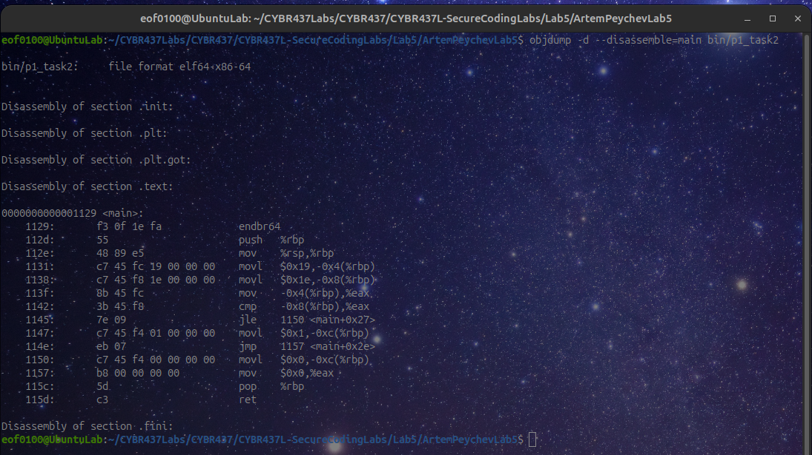

The assembly has the same cmp, jle and jmp instructions as the handout. It also has the two choices that store either 1 or 0

## Task 3

### Code

```c
int fun(int a, int b) {

    // edi and esi bring the two numbers into this function
    // mov saves them on the stack, then loads a into edx b into eax
    // add then takes away - 1

    return a + b - 1;
}

int main(void) {
    // The two movl instructions store 5 and 6
    int a = 5;
    int b = 6;

    // mov puts a in edi and b in esi, then call runs fun.
    // then fun returns. the mov saves the num in a
    a = fun(a, b);
    //  returns 0.
    return 0;
}
```

### What it does

In main, sub takes 16 byts from rsp to make room on the stack. The two movl instructions store 5 in a and 6 in b. Them mov loads b into edx and a into eax. The next two mov instructions put b in esi and a in edi. These registers hold the numbers being passed to fun.

The call instruction runs fun. Inside fun, mov saves the 1st number from edi at rbp minus 4 and the second number from esi at rbp minus 8. It loads a into edx and b into eax. Then add adds the numbers and sub takes away 1.

So fun does 5 plus 6 minus 1 and returns 10. It leaves this result in eax. Back in main, mov saves that result in a at rbp minus 4.

The next mov puts 0 in eax because main returns 0. Leave restores the stack frame and ret goes back to the caller. The push and mov at the start set up the frame, and endbr 64 is for control flow protection.

### Screenshot

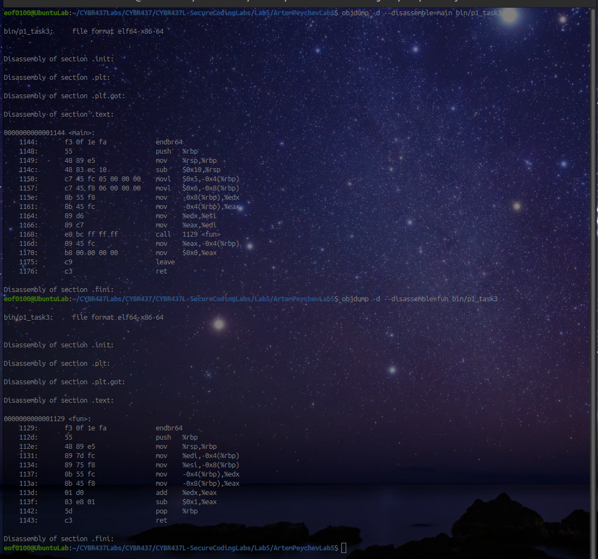

The screenshot shows main passing the numbers to fun, then storing its result. Fun has the same add and subtract 1 instructions as the handotu.

# Part 2: Memory management


## Task 1

The function uses malloc to get 32 bytes but never frees that memory. When the function ends it loses the pointer, so this causes a memory leak.

To fix it I would free text_buffer before return 0. There is already a NULL check, so if malloc fails it returns negative 1 without using the pointer.

## Task 2

The second printf uses pointer after the memory was already freed. This is called use after free. Even if it prints 10 the memory is no longer safe to use.

To fix this I would remove the second printf or move it before free. I would also check if malloc returned NULL before putting 10 into the memory that ptr points to.

I could set ptr to NULL after freeing it so it does not keep the old address. But setting it to NULL still does not make it safe to read through that pointer.

# Part 3: Buffer overflows

I kept stack protection on for these programs. I also used address sanitizer for the array copy so it could show where the program writes outside of the aray. 
## Task 1: City input

### Original code

```c
#include <stdio.h>
int main(void) {
    char city[10];
    printf("Enter city: ");

    // This keeps reading even when the input will not gfit
    scanf("%s", city);
    printf("City: %s\n", city);
    return 0;
}
```

### What is wrong

City only has 10 bytes. It needs one of those bytes for the zero at the end of the string, so only 9 characters fit. Scanf has no limit on how many characters it reads here. So a long name goes past the end of the array.

I used normal_city.txt with Spokane and long_city.txt with a much longer name. I used these same files for both versions.

### Before the fix

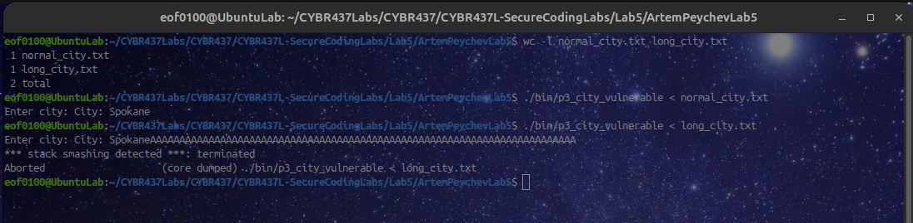

The short city printed correctly. The long input caused a stack smashing detected error and the program stopped. It was too long for the city array.

### After the Fixed code

```c
// Makes getline available on this Linux system.
#define _POSIX_C_SOURCE 200809L
#include <stdio.h>
#include <stdlib.h>
#include <sys/types.h>

int main(void) {
    char *city = NULL;
    size_t capacity = 0;
    printf("Enter city: ");

    // getline will make more space and gets more if needed
    ssize_t length = getline(&city, &capacity, stdin);
    if (length < 0) {
        fprintf(stderr, "Could not read city.\n");
        free(city);
        return 1;
    }
    if (length > 0 && city[length - 1] == '\n') {
        city[length - 1] = '\0';
    }
    printf("City: %s\n", city);
    // free memory after printing the city name
    free(city);
    return 0;
}
```

###  Changes I made

I used getline instead of the small city array and scanf. Getline makes space for the input and adds more space if it needs it. So the whole name fits even if it is long, and the program does not have to reject it.

I also remove the newline at the end and free the memory after printing. If getline cannot read the input the program frees any allocated memory and stops.

### After the fix

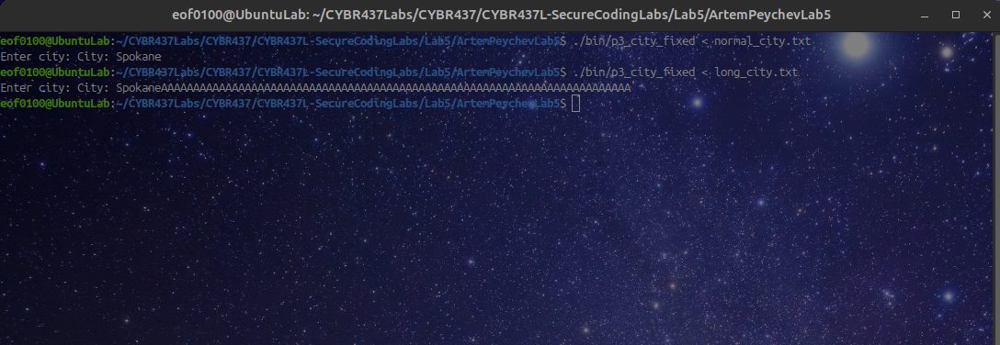

Both short and long city names printed this time without crashing. The buffer could grow so the whole input fit.

## Task 2: Copy Arrau

### Original code

```c
#include <stdio.h>

int fun(double *to, double *from, int pos, int n) {
    int k;
    for (k = 0; k < n; k++) {
        // This does not check if the next value will fit.
        to[pos] = from[k];
        pos++;
    }
    return pos;
}

int main(void) {
    // Destination has 5 spaces and source has 6 numbers.
    double to[5] = {0};
    double from[6] = {10, 20, 30, 40, 50, 60};
    printf("Destination capacity: 5; start: 3; number to copy: 4\n");
    printf("This tries to write destination indexes 3, 4, 5, and 6.\n");
    fflush(stdout);
    // Copy 4 numbers starting at index 3. This goes past the end.
    int end = fun(to, from, 3, 4);
    printf("Returned position: %d\n", end);
    for (int k = 0; k < 5; k++) printf("%.0f ", to[k]);
    printf("\n");
    return 0;
}
```

### Issue with code

The function does not know how much space the destination has. My destination has 5 elements, so its indexes go from 0 to 4. I tried copying 4 values starting at index 3. That tries to write at indexes 3, 4, 5 and 6, but 5 and 6 are outside the array.

The source has 6 elements which is more than the 4 being copied, so the source is large enough for this test.

### Before fixing

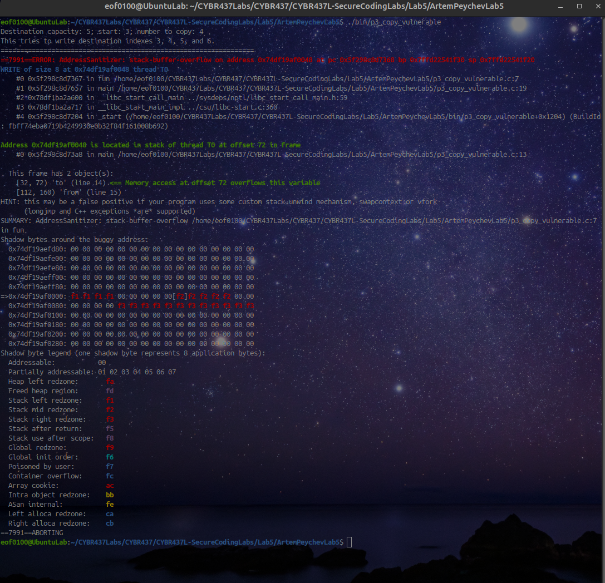

Address sanitizer found a write outside the destination array. It points to line 7 in fun where the value is copied and program stopped when overflow was discovered.

### Fixed code

```c
#include <stdio.h>
#include <stdlib.h>
#include <limits.h>
#include <stdint.h>

int fun(double **to, const double *from, int pos, int n, size_t *capacity) {

    // check position and check if adding the size is going to fit here
    if (pos < 0 || n < 0 || n > INT_MAX - pos) return -1;
    size_t needed = (size_t)pos + (size_t)n;
    // checks bytes will fit
    if (needed > SIZE_MAX / sizeof(double)) return -1;

    // make mroe room if capactiy of array is not enough
    if (needed > *capacity) {

        // keep old pointer
        double *larger = realloc(*to, needed * sizeof(double));
        if (larger == NULL) return -1;
   
        for (size_t k = *capacity; k < needed; k++) larger[k] = 0;
        // Give the updated pointer and size back to main
        *to = larger;
        *capacity = needed;
    }
    // all numbers fit make a copy
    for (int k = 0; k < n; k++) {
        (*to)[pos] = from[k];
        pos++;
    }
    return pos;
}

int main(void) {
    size_t capacity = 5;
    // allocate memory
    double *to = calloc(capacity, sizeof(double));
    double from[6] = {10, 20, 30, 40, 50, 60};
    if (to == NULL) return 1;
    printf("Original capacity: %zu; start: 3; number to copy: 4\n", capacity);
    // Use the same starting position and copy count as before.
    int end = fun(&to, from, 3, 4, &capacity);
    if (end < 0) {
        fprintf(stderr, "Could not complete the copy.\n");
        free(to);
        return 1;
    }
    printf("New capacity: %zu; returned position: %d\n", capacity, end);
    printf("Destination: ");
    for (size_t k = 0; k < capacity; k++) printf("%.0f ", to[k]);
    printf("\n");
    // free array below
    free(to);
    return 0;
}
```

### What I changed

I changed the function so it knows how many elements fit in the destination. If there is not enough room it uses realloc to grow the array. So it can copy all the values instead of rejecting the input.

I used calloc in main because realloc needs allocated memory. It cannot grow the original stack array. I pass the pointer by address so the function can update it if realloc moves the array.

Before making more room I check that the positions are not negative and that the size calculation will fit. I also check the size in bytes. I use a temporary pointer for realloc so I do not lose the old memory if it fails. If there is no memory available the function returns an error. At the end main frees the array.

I used the same 6 source values, starting index 3, copy count 4 and original destination size 5 for this test.

### After the fixing

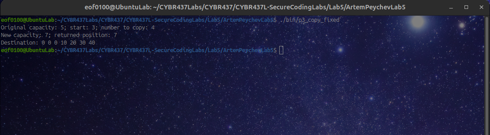

The fixed program increased the array size from 5 to 7. It copied all four values and returned position 7. The array had 0 0 0 10 20 30 40 and there was no overflow error.

# Part 4: Integer overflows

I used int main and int max from limits.h to get the smallest and biggest int values fand I did not write those limit values into the code myself.

I used undenfined behavior sanitizer to check for overflow in the original functions. The overflow is undefined in C, so I cannot rely on it just wrapping around to another number.

## Task 1: Addition

### Code

```c
#include <stdio.h>
#include <limits.h>
#include <string.h>

void fun1(int a, int b) {
    int sum;
    // adds numbers without checks
    sum = a + b;
    printf("Result = %d\n", sum);
}

void fun1_fixed(int a, int b) {
    printf("a = %d, b = %d: ", a, b);


    // positive b makes sum too large and negative b make it too small
    if ((b > 0 && a > INT_MAX - b) ||
        (b < 0 && a < INT_MIN - b)) {
        printf("Error: integer overflow.\n");
        return;
    }
    // print result    
    printf("Result = %d\n", a + b);
}

int main(int argc, char **argv) {
    printf("INT_MIN = %d; INT_MAX = %d\n", INT_MIN, INT_MAX);
    // unsafe args runs original function
    if (argc > 1 && strcmp(argv[1], "unsafe") == 0) {
        printf("Original function: a = INT_MAX, b = 1\n");
        fflush(stdout);
        // the number fit but the sum doesnt fit here
        fun1(INT_MAX, 1);
    } else {
        printf("Corrected function:\n");
        // try same test but with fixed function 
        fun1_fixed(INT_MAX, 1);

        fun1_fixed(INT_MIN, -1);
        // These two aditions should work normal
        fun1_fixed(20, 30);
        fun1_fixed(-20, -30);
    }
    return 0;
}
```

### Original function

I chose a as int max and b as 1. Both numbers fit in an int by themselves. But int max is already the biggest int, so adding 1 makes the result too big.

The original function just adds without checking. Running it with the unsafe argument tests that addition. The sanitizer reports signed integer overflow and stops the program.

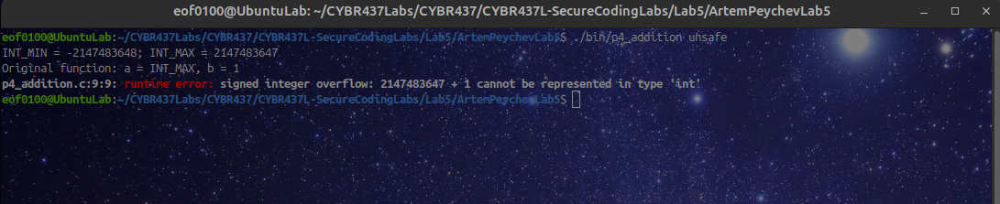

### What I changed

If b is positive I check whether a is bigger than int max minus b. If b is negative I check whether a is smaller than int min minus b. I do this before adding so the check does not wait until after the overflow happened.

If the result would not fit it prints an error and returns. Otherwise it adds the numbers and prints the answer.

### After the fix

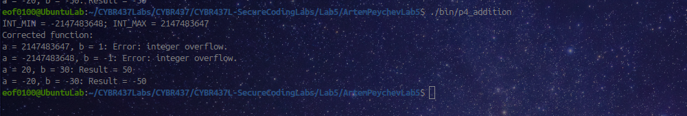

The fixed function printed errors for INT_MAX plus 1 and int min plus negative 1. The normal tests worked. Adding 20 and 30 gave 50, and adding negative 20 and negative 30 gave negative 50. All correct.

## Task 2: Subtraction

### Code

```c
#include <stdio.h>
#include <limits.h>
#include <string.h>

void fun2(int x, int y) {
    int diff;
    // subtracts without check
    diff = x - y;
    printf("Result = %d\n", diff);
}

void fun2_fixed(int x, int y) {
    printf("x = %d, y = %d: ", x, y);

    // subtracting pos num goes below int main
    // subtract neg goes above int max
    if ((y > 0 && x < INT_MIN + y) ||
        (y < 0 && x > INT_MAX + y)) {
        printf("Error: integer overflow.\n");
        return;
    }
    // subtract numbers
    printf("Result = %d\n", x - y);
}

int main(int argc, char **argv) {
    printf("INT_MIN = %d; INT_MAX = %d\n", INT_MIN, INT_MAX);
    // unsafe argument run the orig function
    if (argc > 1 && strcmp(argv[1], "unsafe") == 0) {
        printf("Original function: x = INT_MIN, y = 1\n");
        fflush(stdout);
        // removing - 1 from int min puts it below the limit
        fun2(INT_MIN, 1);
    } else {
        printf("Corrected function:\n");
        // overflow test with function t hat is now fixed
        fun2_fixed(INT_MIN, 1);
        // taking away - 1 checks the upper most limit
        fun2_fixed(INT_MAX, -1);
        // Tworks normally now
        fun2_fixed(30, 20);
        fun2_fixed(-20, 30);
    }
    return 0;
}
```

### Original function

I chose x as Iint min and y as 1. Both fit in an int by themselves. But int min is already the smallest int, so subtracting 1 would go below the limit.

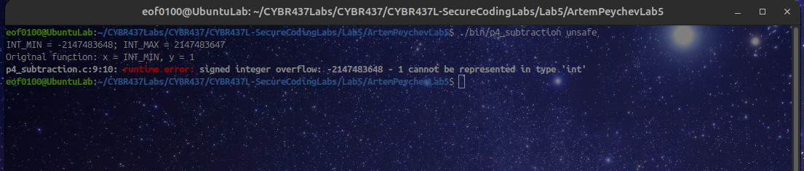

The original function tried subtracting 1 from int min. The sanitizer found signed integer overflow and stopped the program.

### What I changed

If y is positive I check whether x is smaller than int min plus y. If y is negative I check whether x is bigger than integer max + y. These checks happen before subtracting anything. If the result would not fit the function prints an error otherwise it'll subtract and prints the answer.

### After the fix

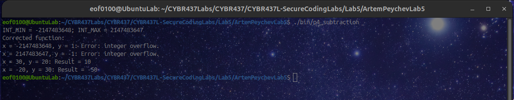

The fixed function printed errors for int main minus 1 and int max minus -1. The normal tests worked. Taking 20 away from 30 gave answer of 10. Taking 30 away from negative 20 gave negative 50 correctly. The program finished without a any errors this time.
